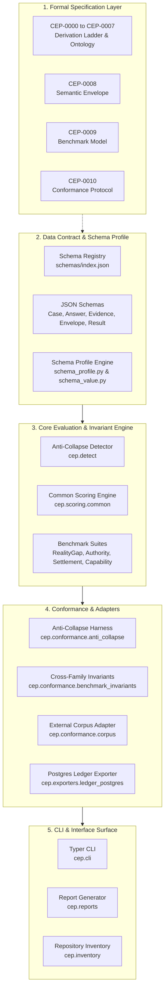
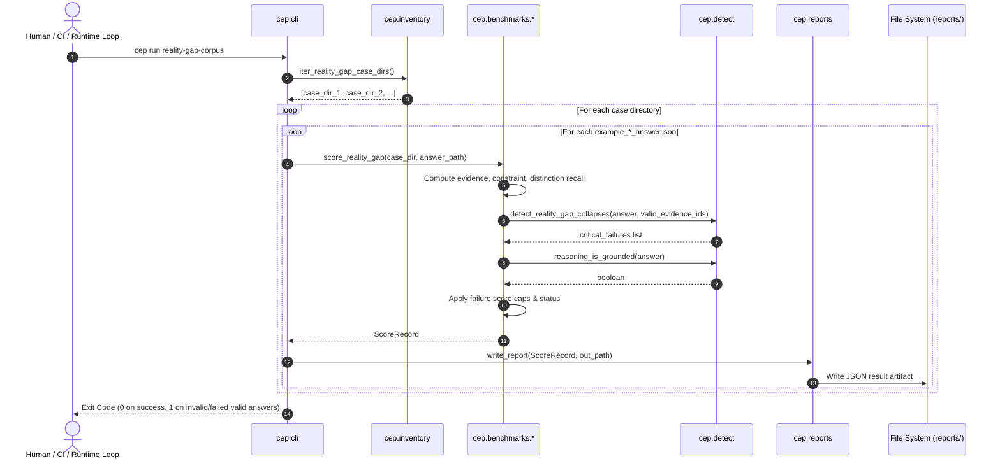
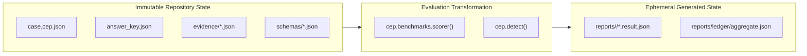

# Canonical Evaluation Protocol: Architecture

## 1. System Identity and Purpose

**Canonical Evaluation Protocol (CEP)** is a vendor-neutral protocol and evaluation engine designed to evaluate represented transformations through evidence-backed settlement across AI systems, autonomous agents, human-machine workflows, and organizations.

CEP resolves a fundamental flaw in contemporary AI evaluation: **semantic collapse**. Conventional evaluation frameworks collapse distinct operational realities into single metrics—treating execution completion as settlement, tool access as capability, policy documentation as authority, or benchmark scores as operational readiness. CEP formally models the ontological pipeline from declared state to settled consequence registration, enforcing hard barriers against semantic collapse.

```text
[Declared State]
       │
       ▼
[Transformation] ──(Attempted / Observed)
       │
       ▼
[Observed State] ──(Registered Telemetry / Traces)
       │
       ▼
   [Question]    ──(Operational Probe)
       │
       ▼
   [Evidence]    ──(Grounded Observations Bound to Question)
       │
       ▼
  [Settlement]   ──(Reliable Consequence Registration)
       │
       ▼
[Affordance / Capability Update]
```

### 1.1 One-Sentence Maintainer Definition
*CEP is a deterministic, content-grounded evaluation engine and schema framework that validates transformation records, calculates multidimensional recall against explicit answer keys, detects semantic collapses in candidate reasoning, and caps evaluation scores when ontological invariants are violated.*

---

## 2. Logical Architecture

The logical architecture separates foundational ontology, formal schemas, invariant detection, evaluation runners, and boundary adapters.



### Explanatory Context
* **What to notice**: The Core Engine (`cep.detect` and `cep.scoring.common`) does not depend on the CLI or the file system layout. It operates on structured memory mappings (`Answer`, `AnswerKey`, `JsonObject`).
* **Why relationships matter**: The schema subsystem enforces that every case, answer, evidence record, and result conforms to strict validation profiles before any scoring logic executes.
* **What is omitted**: Background persistent workers or message brokers are deliberately absent; the logical core is completely stateless and side-effect free outside explicit report emission.

---

## 3. Subsystem Decomposition

| Subsystem | Primary Modules | Primary Responsibility | Non-Responsibilities |
|---|---|---|---|
| **Schema & Validation** | `cep.schema_profile`, `cep.schema_value`, `cep.validation` | Enforcing strict JSON Schema Draft 2020-12 profiles and validating corpus artifacts. | Does not evaluate benchmark accuracy or score answers. |
| **Anti-Collapse Detection** | `cep.detect` | Inspecting submitted candidate answers for 13+ named semantic collapses using content-based inspection. | Does not compute weighted numerical scores or write report files. |
| **Benchmark Suites** | `cep.benchmarks.reality_gap`, `authority`, `settlement`, `capability` | Executing family-specific scoring routines, computing multi-factor recall, and applying failure caps. | Does not parse CLI flags or discover disk paths. |
| **Conformance & External Corpus** | `cep.conformance.anti_collapse`, `benchmark_invariants`, `corpus` | Verifying engine self-defense on fixtures, validating cross-family invariants, and scoring external corpora. | Does not define benchmark schema contracts. |
| **Ledger Exporter & Ratchet** | `cep.exporters.ledger_postgres` | Ingesting real event log rows from Postgres, joining causation evidence, and enforcing regression ratchets. | Does not run arbitrary SQL or manage database migrations. |
| **CLI & Inventory** | `cep.cli`, `cep.inventory`, `cep.reports`, `cep.paths` | Command dispatch, path resolution, case discovery, and emitting standardized JSON result documents. | Does not contain scoring logic or collapse heuristics. |

Detailed guides for each subsystem are available in [Subsystem Documentation](docs/index.md#subsystem-guides):
* [Schema and Validation Subsystem](docs/subsystems/schema-and-validation.md)
* [Anti-Collapse and Conformance Subsystem](docs/subsystems/anti-collapse-and-conformance.md)
* [Benchmark Suites Subsystem](docs/subsystems/benchmark-suites.md)
* [Ledger Exporter and External Integration Subsystem](docs/subsystems/ledger-and-external.md)
* [CLI and Reporting Subsystem](docs/subsystems/cli-and-reporting.md)

---

## 4. Runtime Architecture and Topology

CEP executes as an on-demand, single-process CLI application or as an embedded Python library.



### Runtime Characteristics
* **Concurrency Model**: Synchronous execution. Scorer routines are pure CPU-bound Python functions with minimal disk I/O.
* **Process Lifetime**: Ephemeral. The process initializes, validates, scores, outputs to stdout and JSON reports, and terminates.
* **Working Directory Agnosticism**: Uses `cep.paths.REPO_ROOT` which inspects `CEP_REPO_ROOT`, the current directory, and Python parent directories for `schemas/index.json` and `benchmarks/`.

---

## 5. Dependency Architecture

Internal package dependencies strictly adhere to a directed acyclic graph (DAG) flowing from base utilities up to application entry points.

```text
cep.cli
  ├── cep.benchmarks (reality_gap, authority, settlement, capability)
  │     ├── cep.detect
  │     │     ├── cep.io
  │     │     └── cep.json_types
  │     ├── cep.scoring.common
  │     └── cep.io
  ├── cep.conformance (anti_collapse, benchmark_invariants, corpus)
  │     ├── cep.detect
  │     ├── cep.inventory
  │     └── cep.io
  ├── cep.validation
  │     ├── cep.schema_profile
  │     ├── cep.schema_value
  │     └── cep.inventory
  ├── cep.reports
  │     └── cep.scoring.common
  ├── cep.inventory
  │     └── cep.paths
  └── cep.paths
```

* **Invariants**: Lower-level modules (`cep.detect`, `cep.scoring.common`, `cep.schema_value`) never import from `cep.cli`, `cep.conformance`, or higher-level runners. Circular dependencies are forbidden.

---

## 6. Data Architecture and State Ownership

CEP maintains zero mutable singleton state in memory across invocations. State exists exclusively as version-controlled file artifacts or ephemeral outputs.



### State Boundaries
1. **Case Definition State** (`benchmarks/<family>/cases/<id>/`): Owned by benchmark authors. Contains `case.cep.json` (problem setup), `answer_key.json` (ground truth rules and recall targets), and `evidence/*.json` (grounding records).
2. **Submitted Candidate State** (`example_*_answer.json` or external candidate payload): Owned by the system under test. Contains asserted gap status, cited evidence, reasoning prose, and recommended actions.
3. **Evaluation Result State** (`reports/`): Derived, reproducible, and git-ignored. Validated against `schemas/benchmark-result.schema.json`.
4. **Persistent External Ledger State** (`event_log.agent_events`): Owned by external production runtimes (e.g. Postgres). Ingested read-only by `cep.exporters.ledger_postgres`.

---

## 7. Trust and Security Boundaries

1. **Schema Sandboxing**: All ingested JSON instances (cases, answer keys, candidate answers, external corpora) pass through `pydantic` adapters and `cep.schema_value.validate_value`. Arbitrary Python object deserialization (e.g., `pickle`) is never used.
2. **Path Traversal Protection**: Evidence IDs and case references are restricted to identifiers matching explicit patterns; evidence files are resolved strictly within designated case subdirectories (`case_dir / "evidence"`).
3. **Detection Integrity (F-01 Remediation)**: Candidate answers are evaluated against independent, content-based heuristics in `cep.detect`. The engine never trusts self-declared pass/fail statuses or fixture metadata.
4. **PostgreSQL Read-Only Scope**: The ledger exporter (`cep.exporters.ledger_postgres`) performs parameter-bound read queries against `event_log.agent_events` and writes solely to local report directories.

---

## 8. Source Traceability

* [paths.py](src/cep/paths.py): Repository root auto-discovery (`REPO_ROOT`) and path constants.
* [json_types.py](src/cep/json_types.py): Canonical type aliases (`JsonObject`, `JsonObjectError`).
* [io.py](src/cep/io.py): JSON serialization and deserialization adapters (`load_json`, `write_json`).
* [detect.py](src/cep/detect.py): Content-based collapse detection (`detect_reality_gap_collapses`, `reasoning_is_grounded`).
* [schema_profile.py](src/cep/schema_profile.py): Strict JSON Schema keyword validation (`schema_profile_errors`).
* [schema_value.py](src/cep/schema_value.py): Instance validation engine (`validate_value`, `validate_object`).
* [validation.py](src/cep/validation.py): Corpus and schema registry validators (`validate_all_schemas`, `validate_reality_gap_corpus`).
* [scoring/common.py](src/cep/scoring/common.py): Core metrics and thresholds (`recall`, `status_from_score`, `ScoreRecord`).
* [benchmarks/reality_gap.py](src/cep/benchmarks/reality_gap.py): Scorer for RealityGapBench (`score_reality_gap`, `CRITICAL_FAILURE_CAPS`).
* [benchmarks/authority.py](src/cep/benchmarks/authority.py): Scorer for AuthorityBench (`score_authority`).
* [benchmarks/settlement.py](src/cep/benchmarks/settlement.py): Scorer and call surface for SettlementBench (`score_settlement`, `from_settlement_recorded`).
* [benchmarks/capability.py](src/cep/benchmarks/capability.py): Scorer for CapabilityBench (`score_capability`).
* [conformance/anti_collapse.py](src/cep/conformance/anti_collapse.py): Conformance harness for RealityGap anti-collapse fixtures (`run_reality_gap_anti_collapse`).
* [conformance/benchmark_invariants.py](src/cep/conformance/benchmark_invariants.py): Cross-family invariant enforcement (`run_benchmark_anti_collapse`).
* [conformance/corpus.py](src/cep/conformance/corpus.py): External corpus evaluation harness (`evaluate_corpus`).
* [exporters/ledger_postgres.py](src/cep/exporters/ledger_postgres.py): Database ingestion and ratchet logic (`export_settlement_corpus`, `ratchet_against`).
* [cli.py](src/cep/cli.py): Typer CLI command definitions.
