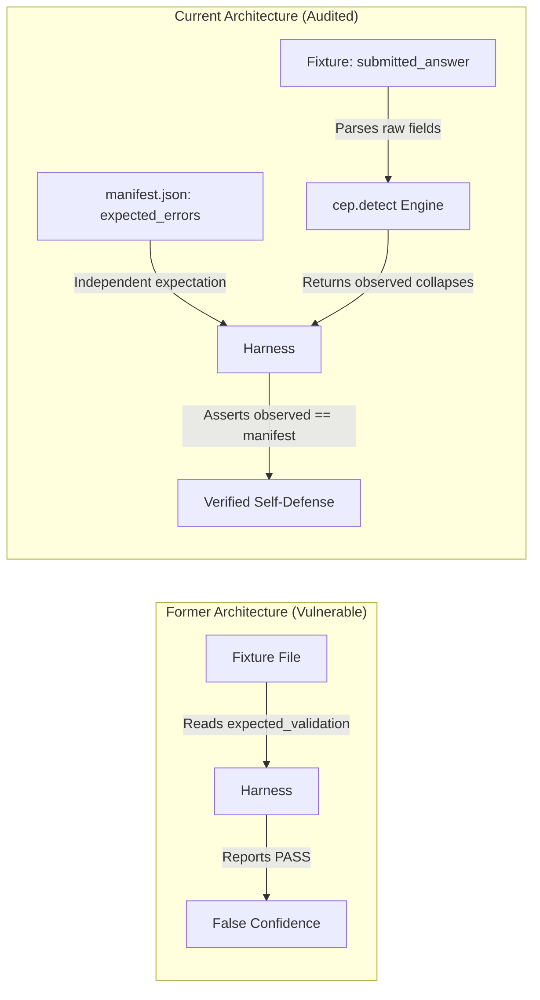

# Why Content-Based Detection Replaced Fixture Self-Declaration

## 1. The Audit Discovery (Finding F-01)

During the protocol audit documented in `.agents/reports/final_protocol_audit.md`, a critical vulnerability was uncovered in the initial implementation of the conformance harness:

### The Vulnerability: Tautological Conformance
Prior to the remediation, conformance fixtures in `conformance/fixtures/anti-collapse/reality-gap/` contained an `expected_validation` block:
```json
{
  "fixture_id": "rg-ac-0001",
  "expected_validation": {
    "status": "invalid",
    "errors": ["declared_observed_collapse"]
  }
}
```
The early test runner checked the fixture by reading `expected_validation["errors"]` from the JSON fixture file and asserting that the errors were present. The evaluation engine never actually evaluated the `submitted_answer` payload.

As a result:
* The conformance suite proved only that JSON files could be read.
* It proved nothing about whether the Python evaluation engine could detect semantic collapses.
* An answer committing a blatant collapse could pass in production because the detector was never exercised.

---

## 2. The Remediation Design: `cep.detect`

To eliminate this vulnerability, the engine was restructured around a single, content-grounded detector module: `src/cep/detect.py`.



### Key Principles of the Redesign
1. **Zero Trust for In-Fixture Verdicts**: The harness completely ignores `fixture.expected_validation` when computing engine behavior.
2. **Ground Truth from Independent Manifest**: The expected failure codes are maintained in `conformance/fixtures/anti-collapse/reality-gap/manifest.json`.
3. **Single Source of Detection Truth**: Both the candidate answer scorer (`cep.benchmarks.reality_gap`) and the conformance test harness (`cep.conformance.anti_collapse`) invoke the exact same function: `detect_reality_gap_collapses()`.

---

## 3. Why Answers are Inspected via Heuristics Rather Than Arbitrary LLM Judges

A natural question is: *Why does `cep.detect` use deterministic pattern and reference heuristics rather than prompting an LLM to judge semantic collapses?*

### Reasons for Deterministic Heuristics
1. **Falsifiability and Reproducibility**: Benchmark evaluation must produce byte-stable, deterministic results across runs. LLM judges introduce stochastic variance and prompt drift.
2. **Infinite Regress Prevention**: If an LLM judge is used to evaluate whether an agent collapsed "authority into capability", who evaluates the judge for semantic collapse? Deterministic code breaks the recursion.
3. **Execution Speed and Portability**: The entire 67-test suite runs in less than half a second without requiring API keys, network access, or GPU hardware.

---

## 4. Trade-Offs and Known Limitations

* **Prose Variation Sensitivity**: Heuristics rely on regex patterns and keyword families (e.g., `"complet"` and `"settl"`). A candidate answer could theoretically use novel phrasing that avoids the pattern while committing the collapse.
* **Corpus Breadth Requirement**: Because heuristics are intentionally strict, growing the benchmark corpus requires ongoing human review (OQ-0005) to ensure that valid candidate phrasing is not falsely flagged as collapsed.

---

## 5. Source Trail

* [src/cep/detect.py](../../src/cep/detect.py) — Content-based collapse detection engine
* [src/cep/conformance/anti_collapse.py](../../src/cep/conformance/anti_collapse.py) — Independent manifest verification
* `.agents/reports/final_protocol_audit.md` (local working report; `reports/` is gitignored, so it is not in a fresh checkout) — Complete audit report detailing F-01 through F-11
* [tests/test_anti_collapse_conformance.py](../../tests/test_anti_collapse_conformance.py) — Engine verification tests
