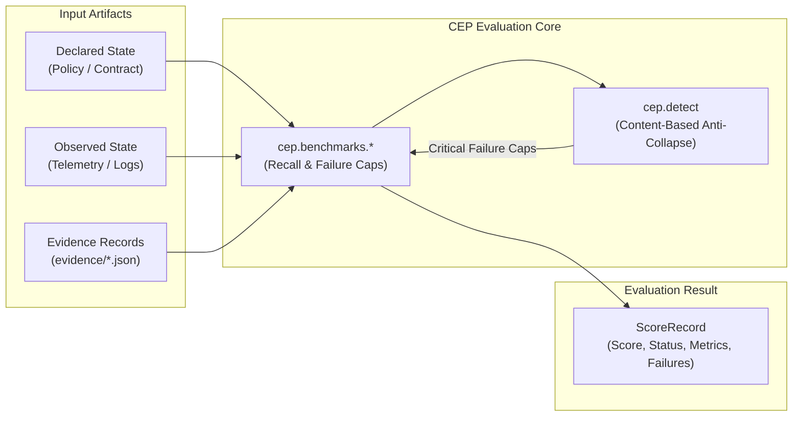

# Canonical Evaluation Protocol: Documentation Knowledge System

Welcome to the technical knowledge base for the **Canonical Evaluation Protocol (CEP)**. This documentation functions as an architectural map, operational handbook, and conceptual guide for both newcomers and experienced systems engineers.

---

## 1. What This Project Is

The **Canonical Evaluation Protocol (CEP)** is a vendor-neutral protocol and deterministic evaluation engine for evaluating represented transformations across AI systems, autonomous agents, tools, workflows, and organizations.

CEP evaluates **what changed**, **what evidence supports the change**, **whether the result settled**, and **whether repeated settled performance justifies a capability claim**. It is not a benchmark leaderboard, an agent framework, or a prompt template—it is the rigorous evaluation substrate beneath them.

---

## 2. What Problem It Solves

Most automated evaluation frameworks collapse critical operational boundaries:
* They treat **task execution** as **settlement**.
* They treat **tool access** as **authority**.
* They treat **asserted claims** as **grounded evidence**.
* They treat **isolated benchmark scores** as **repeatable capability**.
* They treat **declared policy** as **observed reality**.

When an agent or model blurs these boundaries, it creates catastrophic blind spots in safety, governance, and capability assessment. CEP formally models these distinctions, detects when an answer commits a semantic collapse, and applies deterministic score caps so that gaming surface labels can never earn a passing score.

---

## 3. The System in One Picture

---

## 4. The Core Concepts You Need First

1. **Declared State**: What a policy, specification, contract, or prompt asserts should be true.
2. **Observed State**: What actually occurred in the environment, verifiable via logs, execution traces, or artifacts.
3. **Reality Gap**: A divergence between declared state and observed state.
4. **Evidence**: An empirical observation specifically bound to an operational question to verify or refute a claim.
5. **Settlement**: The reliable, verifiable registration of consequence (distinct from merely finishing execution).
6. **Semantic Collapse**: The error of substituting an easily measured proxy for an underlying operational reality (e.g. treating a test pass as proof of settlement).
7. **Failure Cap**: A hard mathematical ceiling applied to an evaluation score when a candidate commits a semantic collapse.
8. **Semantic Envelope**: The standardized, portable JSON structure (`cep-semantic-envelope.schema.json`) for transporting transformation context across system boundaries.

---

## 5. A Representative Journey

Consider evaluating an autonomous agent that claims to have rotated a cryptographic key:

1. **Declared State**: Security policy requires key rotation every 30 days and dual-custody authorization.
2. **Execution Attempt**: The agent runs a script and reports: *"Key rotation complete."*
3. **Reality Gap Probe**: RealityGapBench queries: *Where does declared state diverge from observed state?*
4. **Candidate Answer**: The agent submits an answer claiming `gap_status = "no_gap_detected"`, citing its own execution logs as proof of authority.
5. **Content-Based Detection**: `cep.detect` inspects the answer prose and citations, detecting:
   * `authority_capability_collapse` (the agent treated execution capability as authorization).
   * `completion_settlement_collapse` (the agent treated script completion as consequence settlement).
6. **Result**: The candidate's raw score is overridden by critical failure caps. Its final score is capped at `35.0`, and its status is marked as `invalid`.

---

## 6. Navigate by Intent

Choose the documentation path that matches your current goal:

### Learn the System
* [System Mental Model](mental-model.md) — Conceptual structure, ontological derivation, and state boundaries.
* [Canonical Architecture Specification](../architecture.md) — Logical, runtime, dependency, and data architectures.
* [Subsystem Guides](#subsystem-guides) — Deep dives into each component module.

### Get Something Done
* [Getting Started](getting-started.md) — Fast environment setup and execution.
* [Running the Benchmarks](running-benchmarks.md) — Guide to running families and reading outputs.
* [Tutorial: Scoring Your First RealityGap Answer](tutorials/first-reality-gap-evaluation.md) — Guided hands-on scoring walkthrough.
* [Tutorial: Authoring a Benchmark Case](tutorials/authoring-a-benchmark-case.md) — How to construct and validate a new case.
* [Authoring Benchmark Cases Guide](authoring-cases.md) — Protocol standards for human review.

### Understand Why
* [Why CEP Exists: Preventing Semantic Collapse](explanation/preventing-semantic-collapse.md) — The derivation ladder and foundational philosophy.
* [Why Content-Based Detection Replaced Fixtures](explanation/content-based-detection-rationale.md) — Audit finding F-01 and the shift away from tautological testing.
* [Why Hard Score Caps and Multi-Factor Recall are Enforced](explanation/scoring-and-failure-caps.md) — Mathematical rationale for failure caps and the 84.0 ungrounded ceiling.
* [Why Decoupled Call Surfaces and Ratchets were Designed](explanation/integration-and-ratchet-design.md) — Production integration philosophy.

### Follow Operational Workflows
* [Startup and Inventory Discovery Workflow](workflows/startup-and-discovery.md) — Initialization and path resolution trace.
* [RealityGap Evaluation Workflow](workflows/reality-gap-evaluation.md) — End-to-end execution path for answer scoring.
* [Conformance Verification Workflow](workflows/conformance-verification.md) — Self-defense verification trace.
* [External Corpus Evaluation Workflow](workflows/external-corpus-evaluation.md) — Third-party corpus ingestion trace.
* [Ledger Export and Ratchet Workflow](workflows/ledger-export-and-ratchet.md) — Live PostgreSQL extraction and regression ratchet trace.

### Look Something Up
* [CLI Command Reference](reference/cli.md) — Complete flag, option, and exit code reference.
* [JSON Schema Reference](reference/schemas.md) — Registered schemas, properties, and constraints.
* [Anti-Collapse Error Codes Reference](reference/anti-collapse-codes.md) — Complete catalog of collapse codes, triggers, and caps.
* [Scoring Metrics and Thresholds Reference](reference/scoring-metrics.md) — Decision matrix and score thresholds.
* [Repository Layout Reference](reference/repository-layout.md) — Physical file layout and directory anatomy.
* [Settlement Scoring Call Surface](settlement-call-surface.md) — Public API contract for live agent loops.

### Troubleshoot & Diagnose
* [Troubleshooting and Diagnostics Guide](troubleshooting.md) — Symptoms, causes, diagnostic commands, and remedies.

### Find the Implementation
* [Complete Source Map](../source-map.md) — Trace concepts and capabilities to concrete files, classes, and lines.
* [Documentation Map](../documentation-map.md) — Master index of all pages and Diátaxis classifications.

---

## 7. Subsystem Guides

Each major subsystem has a dedicated technical guide:
* [Schema and Validation Subsystem](subsystems/schema-and-validation.md) — Schema profile enforcement and instance validation.
* [Anti-Collapse and Conformance Subsystem](subsystems/anti-collapse-and-conformance.md) — Content-based collapse detection and test harnesses.
* [Benchmark Suites Subsystem](subsystems/benchmark-suites.md) — RealityGap, Authority, Settlement, and Capability scorers.
* [Ledger Exporter and External Integration Subsystem](subsystems/ledger-and-external.md) — PostgreSQL ingestion and performance ratchet.
* [CLI and Reporting Subsystem](subsystems/cli-and-reporting.md) — Typer routing, path discovery, inventory, and reporting.

---

## 8. Normative Specifications

The foundational normative specifications are located in `spec/`:
* [CEP-0000: Derivation Ladder and First Principles](../spec/CEP-0000-derivation-ladder.md)
* [CEP-0001: Ontology](../spec/CEP-0001-ontology.md)
* [CEP-0002: Representation Model](../spec/CEP-0002-representation-model.md)
* [CEP-0003: State Model](../spec/CEP-0003-state-model.md)
* [CEP-0004: Transformation Model](../spec/CEP-0004-transformation-model.md)
* [CEP-0005: Question Model](../spec/CEP-0005-question-model.md)
* [CEP-0006: Evidence Model](../spec/CEP-0006-evidence-model.md)
* [CEP-0007: Settlement Model](../spec/CEP-0007-settlement-model.md)
* [CEP-0008: Semantic Envelope](../spec/CEP-0008-semantic-envelope.md)
* [CEP-0009: Benchmark Model](../spec/CEP-0009-benchmark-model.md)
* [CEP-0010: Conformance](../spec/CEP-0010-conformance.md)
