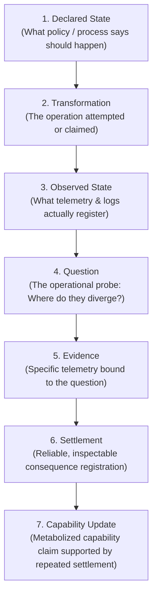

# System Mental Model

## 1. The Core Intuition: Evaluation via Evidence-Backed Settlement

To understand the Canonical Evaluation Protocol (CEP), start with a fundamental question:
*How do we know whether an autonomous agent or system actually possesses a capability?*

In standard practice, we run an automated test or check if an API returned HTTP 200. If the output appears plausible, we grant success.

CEP rejects this assumption. An output is merely a string or bit sequence. An execution is merely a process transition. An action can complete mechanically while leaving real-world dependencies broken, unauthorized, or unsettled.

CEP models evaluation not as checking outputs, but as **evaluating represented transformations through evidence-backed settlement**.

---

## 2. The Transformation Pipeline

Every evaluation in CEP traverses seven distinct stages:



### Stage Explanations
1. **Declared State**: What an organization, contract, policy, or specification asserts *should* be true.
2. **Transformation**: The action or state change initiated by an agent or actor.
3. **Observed State**: The empirical evidence (telemetry, event logs, file snapshots) left in the environment.
4. **Question**: An explicit operational inquiry comparing declared and observed states.
5. **Evidence**: Observations specifically cited to verify or falsify claims regarding the question.
6. **Settlement**: The state where all side-effects have concluded, invariants are satisfied, and consequences are durable and inspectable.
7. **Capability Update**: A justified update to an agent's affordance model, earned only through repeatable settlement.

---

## 3. The Anti-Collapse Barrier

The central architectural invariant of CEP is **Anti-Collapse**. A semantic collapse occurs whenever a system substitutes an easy-to-measure proxy for an underlying operational reality.

```text
  [ Superficial Proxy ]                [ Operational Reality ]
  ─────────────────────                ───────────────────────
  Mechanical Completion        ≠       Settled Consequence
  Tool Capability              ≠       Policy Authority
  Benchmark Score              ≠       Repeatable Capability
  Raw Data / Logs              ≠       Grounded Evidence
  Asserted Claim               ≠       Verified Evidence
  Declared Expectation         ≠       Observed Telemetry
```

When an evaluation system collapses these pairs, it becomes vulnerable to gaming, sycophancy, and premature trust. CEP builds deterministic code barriers (`src/cep/detect.py`) to detect when a candidate answer commits any of these collapses and severely caps its score.

---

## 4. The 5 Core Abstractions in Code

| Abstraction | Where it Lives | What it Represents |
|---|---|---|
| **`Case`** | `case.cep.json` | A concrete scenario defining declared policy, observed telemetry, and the primary question. |
| **`AnswerKey`** | `answer_key.json` | Ground truth rules defining accepted answers, required evidence IDs, and required distinctions. |
| **`Answer`** | Candidate JSON | A candidate system's submitted response: asserted status, citations, and reasoning prose. |
| **`ScoreRecord`** | `cep.scoring.common` | A frozen evaluation result combining numerical recall metrics, status, warnings, and failure caps. |
| **`SemanticEnvelope`** | `schemas/cep-semantic-envelope.schema.json` | The canonical portable JSON envelope used to transport transformation context across systems without semantic drift. |

---

## 5. Next Steps
* Learn how the architecture implements these abstractions in [Architecture Overview](../architecture.md).
* Walk through an evaluation from end to end in [RealityGap Evaluation Workflow](workflows/reality-gap-evaluation.md).
* Inspect the technical dictionary in [Anti-Collapse Error Codes Reference](reference/anti-collapse-codes.md).
