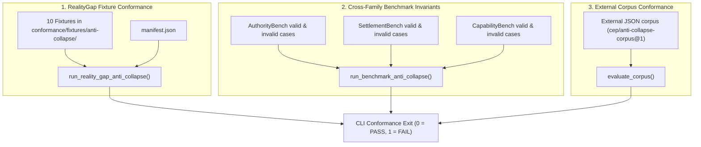

# Anti-Collapse and Conformance Subsystem

## 1. Purpose
The Anti-Collapse and Conformance Subsystem protects the protocol's core epistemological boundaries. It provides content-based detection of semantic collapses in candidate answers and runs automated conformance suites that prove the evaluation engine actively catches violations.

---

## 2. Responsibilities and Non-Responsibilities

### Responsibilities
* **Content-Based Collapse Detection**: Parsing candidate answers (reasoning prose, citations, confidence, actions, relations) and returning active collapse codes.
* **Grounded Reasoning Verification**: Confirming that answers claiming a reality gap explicitly ground their reasoning in both declared and observed state.
* **Harness Execution**: Running the 10 RealityGap dedicated anti-collapse fixtures and verifying that engine-detected errors match the manifest.
* **Cross-Family Invariant Enforcement**: Verifying that `example_invalid_answer` in every benchmark family triggers a critical failure and `example_valid_answer` passes.
* **External Corpus Conformance (L2 Level Gate)**: Ingesting and evaluating external third-party evaluation records (`cep/anti-collapse-corpus@1`) through the same detector.

### Non-Responsibilities
* **Self-Declaration Trust**: Does not trust `expected_validation` or declared statuses inside fixtures (remediated in audit finding F-01).
* **Numerical Score Calculation**: Does not calculate raw score points or recall metrics (delegated to `cep.scoring.common`).

---

## 3. Position in the System

```text
       [Submitted Candidate Answer] ──┐
                                      ├──> [cep.detect.detect_reality_gap_collapses()]
[Case Grounding (evidence/ files)] ──┘                     │
                                                           ▼
                                               [Detected Collapse Codes]
                                                           │
                     ┌─────────────────────────────────────┴─────────────────────────────────────┐
                     ▼                                                                           ▼
       [cep.benchmarks.reality_gap]                                                [cep.conformance.anti_collapse]
                     │                                                                           │
        (Applies failure caps to score)                              (Compares observed codes against manifest)
```

---

## 4. Core Heuristics and Collapse Codes

The engine detects 13 distinct collapse codes in `src/cep/detect.py`:

| Collapse Code | Protected Distinction | Heuristic Trigger |
|---|---|---|
| `declared_observed_collapse` | `declared state ≠ observed state` | `declared_state_refs` and `observed_state_refs` are non-empty and set-identical. |
| `claim_as_evidence` | `claim ≠ evidence` | Answer cites an `evidence_ref` that does not exist in the case's `evidence/` directory. |
| `summary_source_collapse` | `summary ≠ source` | Citing summary artifacts as evidence, or asserting a gap with zero declared/observed refs. |
| `completion_settlement_collapse` | `completion ≠ settlement` | Answer asserts `no_gap_detected` while containing "complet" and "settl" in prose. |
| `ci_approval_collapse` | `CI pass ≠ peer approval` | Answer asserts `no_gap_detected` on the basis that a CI pipeline passed. |
| `possibility_affordance_collapse` | `possibility ≠ affordance` | Relation contains `can_perform` or prose says "able to perform", followed by "proceed". |
| `authority_capability_collapse` | `authority ≠ capability` | Answer treats execution capability as authorization to perform the operation. |
| `unknown_as_false` | `unknown ≠ false` | Inferring failure or gap from a missing log without acknowledging absence. |
| `missing_evidence_as_no_gap` | `missing evidence ≠ no gap` | Asserting `no_gap_detected` because no evidence record was found. |
| `score_capability_collapse` | `score ≠ capability` | Claiming operational capability based on benchmark score or single-run success. |
| `opposite_answer_with_high_confidence` | `confidence ≠ correctness` | Asserting `no_gap_detected` with high confidence when the case answer key strictly forbids it. |

### Grounded Reasoning Rule (`reasoning_is_grounded`)
A candidate asserting a gap must mention both `"declared"` and `"observed"` within its `gap_summary`. If omitted, the answer receives an `ungrounded_reasoning` warning and is hard-capped at 84.0 (cannot achieve `pass`).

---

## 5. Conformance Verification Architecture

The conformance suite operates across three layers:



---

## 6. Failure Modes and Diagnostics

| Symptom | Cause | Diagnostic Command | Remedy |
|---|---|---|---|
| `Missing expected failures: ['declared_observed_collapse']` | Engine detector failed to identify a collapse present in the fixture. | `uv run cep conformance anti-collapse` | Debug `src/cep/detect.py` heuristics against fixture contents. |
| `AuthorityBench auth-0001 invalid: status=pass` | An invalid example answer erroneously scored as pass. | `uv run cep conformance anti-collapse` | Ensure the invalid example answer exhibits the collapse and the scorer catches it. |
| `unsupported corpus schema` | External corpus has invalid `$schema` identifier. | `uv run cep conformance anti-collapse --corpus <file>` | Set `$schema` to `"cep/anti-collapse-corpus@1"`. |

---

## 7. Extension Points

1. **Adding a Detection Heuristic**:
   * Add failure identifier to `src/cep/detect.py` in `detect_reality_gap_collapses()`.
   * Add score cap mapping in `CRITICAL_FAILURE_CAPS` in `src/cep/benchmarks/reality_gap.py`.
   * Add corresponding fixture in `conformance/fixtures/anti-collapse/reality-gap/` and register in `manifest.json`.
2. **Authoring Conformance Fixtures**:
   * Follow guide in [Anti-Collapse Reference](../anti-collapse.md).

---

## 8. Source Trail

* [detect.py](../../src/cep/detect.py) — `detect_reality_gap_collapses()`, `reasoning_is_grounded()`, `valid_evidence_ids()`
* [anti_collapse.py](../../src/cep/conformance/anti_collapse.py) — `run_reality_gap_anti_collapse()`, `check_fixture()`
* [benchmark_invariants.py](../../src/cep/conformance/benchmark_invariants.py) — `run_benchmark_anti_collapse()`, `_check_case()`
* [corpus.py](../../src/cep/conformance/corpus.py) — `load_corpus()`, `evaluate_corpus()`, `CorpusRecord`
* [tests/test_anti_collapse_conformance.py](../../tests/test_anti_collapse_conformance.py) — Dedicated fixture unit tests
* [tests/test_benchmark_invariants.py](../../tests/test_benchmark_invariants.py) — Invariant suite unit tests
