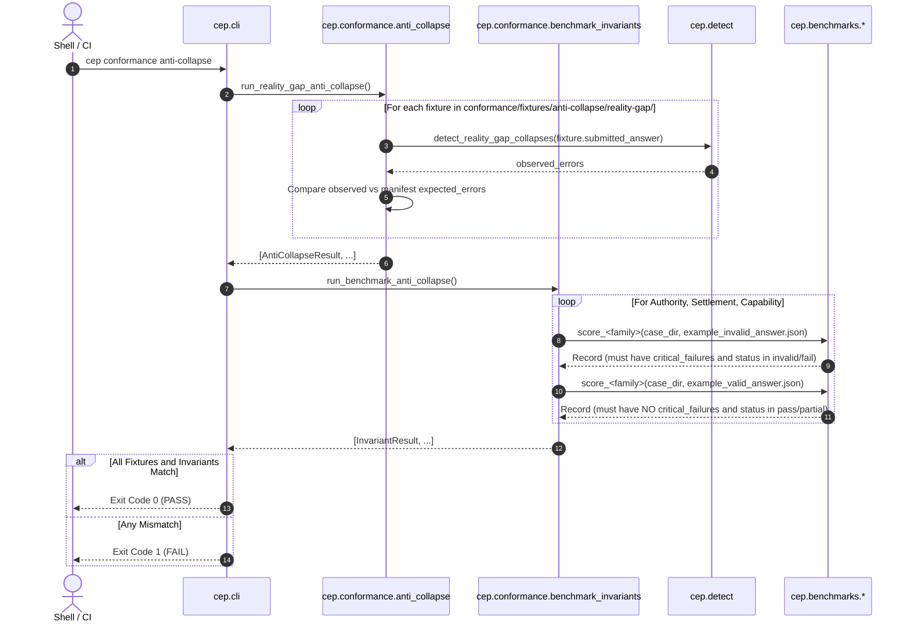

# Conformance Verification Workflow

## 1. Summary
The Conformance Verification Workflow runs the protocol's automated self-defense test. Triggered via `cep conformance anti-collapse`, it proves that the evaluation engine actively catches semantic collapses on dedicated negative fixtures and enforces the rule that valid example answers pass while invalid example answers fail across all benchmark families.

---

## 2. Sequence Diagram

---

## 3. Detailed Execution Path

1. **RealityGap Fixture Verification** (`cep.conformance.anti_collapse`):
   * Loads `conformance/fixtures/anti-collapse/reality-gap/manifest.json`.
   * Maps each fixture file name to its declared `expected_errors`.
   * For each fixture (`rg-ac-0001.json` through `rg-ac-0010.json`), loads the JSON document and extracts `submitted_answer`.
   * Calls `cep.detect.detect_reality_gap_collapses` on the answer.
   * Compares `observed_errors` with `expected_errors`.
   * Marks fixture as OK only if `missing_errors = set(expected) - set(observed)` is empty.
2. **Cross-Family Invariant Verification** (`cep.conformance.benchmark_invariants`):
   * Iterates through `AuthorityBench`, `SettlementBench`, and `CapabilityBench` case directories.
   * Evaluates `example_invalid_answer.json`: verifies that `record.critical_failures` is non-empty and `record.status` is `invalid` or `fail`.
   * Evaluates `example_valid_answer.json`: verifies that `record.critical_failures` is empty and `record.status` is `pass` or `partial`.
3. **Console Reporting and Termination**:
   * Prints `PASS` or `FAIL` for each fixture and family case.
   * If every fixture and invariant succeeded, exits with `0`. Otherwise exits with `1`.

---

## 4. State Changes
* **Disk Output**: None. Conformance checks are completely non-mutating.

---

## 5. Failure Branches

* **Branch 5a: False Negative in Detector**:
  * *Condition*: A fixture contains a collapse, but `cep.detect` does not flag it (manifest expected error missing from observed errors).
  * *Result*: Conformance harness reports `FAIL rg-ac-00XX: Missing expected failures` and exits 1.
* **Branch 5b: Invalid Answer Passed (Invariant Regression)**:
  * *Condition*: An invalid answer example is modified or scorer logic relaxed such that it passes without a critical failure.
  * *Result*: Invariant check fails with `status=pass critical_failures=[]`; exits 1.

---

## 6. Source Trail

* [anti_collapse.py](../../src/cep/conformance/anti_collapse.py) — `run_reality_gap_anti_collapse()`, `check_fixture()`
* [benchmark_invariants.py](../../src/cep/conformance/benchmark_invariants.py) — `run_benchmark_anti_collapse()`, `_check_case()`
* [detect.py](../../src/cep/detect.py) — `detect_reality_gap_collapses()`
* [cli.py](../../src/cep/cli.py) — `conformance_anti_collapse_command()`
