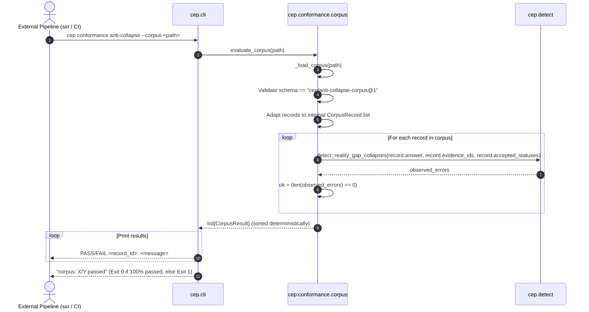

# External Corpus Evaluation Workflow

## 1. Summary
The External Corpus Evaluation Workflow implements the CEP-0010 Level 2 conformance gate. It allows external toolchains (such as `sxr`) to submit exported evaluation corpora (`cep/anti-collapse-corpus@1`) to CEP's independent evaluation engine. CEP acts as the definitive semantic authority, evaluating each external record with `cep.detect.detect_reality_gap_collapses` and rejecting self-judging by external systems.

---

## 2. Sequence Diagram



---

## 3. Detailed Execution Path

1. **CLI Invocation**:
   * Invoked via `cep conformance anti-collapse --corpus path/to/corpus.json`.
2. **Boundary Validation & Adaptation** (`cep.conformance.corpus`):
   * Loads JSON payload. If parsing fails, raises `CorpusError`.
   * Asserts `$schema` or `schema` equals `"cep/anti-collapse-corpus@1"`.
   * Enforces that `records` is an array and each entry carries a non-empty `record_id`.
   * Normalizes transport envelope into internal `CorpusRecord` dataclass:
     ```python
     CorpusRecord(
         record_id=rec.record_id,
         record_ref=rec.record_ref,
         answer=rec.submitted_answer,
         valid_evidence_ids=list(rec.valid_evidence_ids),
         accepted_gap_statuses=list(rec.accepted_gap_statuses),
     )
     ```
3. **Independent Detection**:
   * Reuses `cep.detect.detect_reality_gap_collapses()` verbatim for each record.
   * Compares the record's answer against its declared evidence IDs and accepted gap statuses.
   * If `observed_errors` is non-empty, `ok = False`.
4. **Deterministic Aggregation and Output**:
   * Results are sorted by `record_id` ensuring byte-stable output across runs.
   * Prints individual status lines followed by summary ratio: `corpus: X/Y passed`.
   * If any record failed, exits with code `1`. If all passed, exits with code `0`.

---

## 4. State Changes
* **Disk State**: Non-mutating.

---

## 5. Failure Branches

* **Branch 5a: Schema Incompatibility**:
  * *Condition*: External document specifies an unsupported or misspelled schema version (e.g. `cep/corpus@2`).
  * *Result*: Throws `CorpusError` with explanation; CLI prints `ERROR unsupported corpus schema ...` and exits with code `2`.
* **Branch 5b: Ontological Collapse in External Record**:
  * *Condition*: One or more records commit an anti-collapse violation (e.g. citing ungrounded claims or conflating completion with settlement).
  * *Result*: Record flagged as `FAIL <record_id>: Violated invariants: <codes>`; process exits with code `1`.

---

## 6. Source Trail

* [corpus.py](../../src/cep/conformance/corpus.py) — `load_corpus()`, `evaluate_corpus()`, `_load_corpus()`, `CorpusError`
* [detect.py](../../src/cep/detect.py) — `detect_reality_gap_collapses()`
* [cli.py](../../src/cep/cli.py) — `conformance_anti_collapse_command()`
* [tests/test_anti_collapse_corpus.py](../../tests/test_anti_collapse_corpus.py) — External corpus evaluation tests
