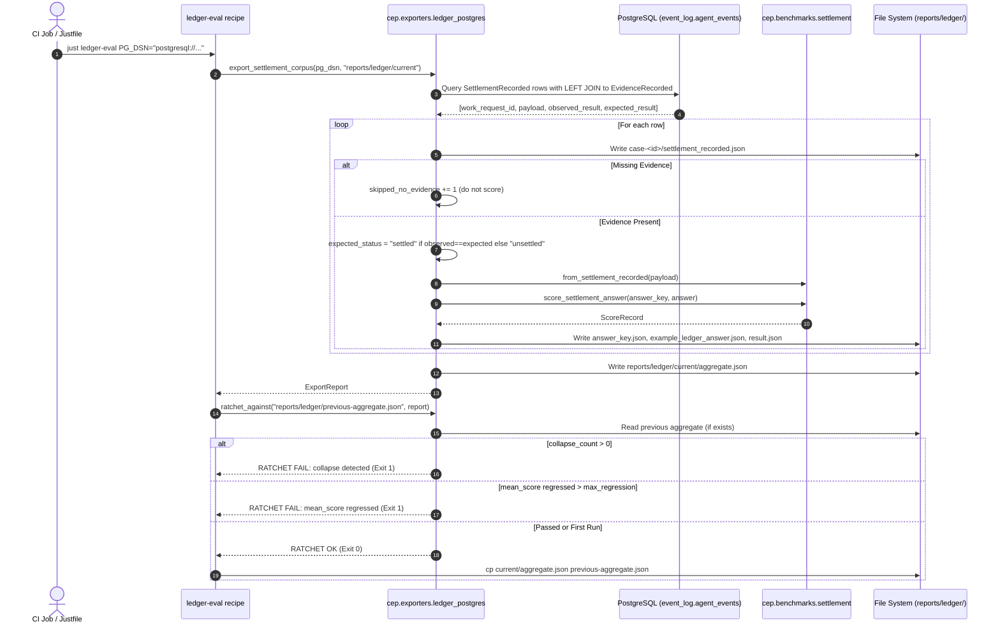

# Ledger Export and Ratchet Workflow

## 1. Summary
The Ledger Export and Ratchet Workflow (WP-7, F-11) bridges real-world execution events stored in a PostgreSQL database into scored CEP benchmark artifacts. It extracts `SettlementRecorded` events, joins them to their causal `EvidenceRecorded` rows to establish ground truth, scores each case via the synchronous `score_settlement_answer` API, generates an aggregate summary, and compares it against previous historical performance, failing on quality regression or semantic collapse.

---

## 2. Sequence Diagram

---

## 3. Detailed Execution Path

1. **Invocation**:
   * Invoked via `just ledger-eval PG_DSN="..."` or Python script.
2. **Database Query**:
   * Connects via `psycopg.connect(pg_dsn)`.
   * Executes parameter-bound query joining `SettlementRecorded` to `EvidenceRecorded` matching on `work_request_id` and `proof_result_id`.
3. **Case Extraction and Scoring**:
   * For each row, creates directory `reports/ledger/current/case-<work_request_id>/`.
   * Writes raw event into `settlement_recorded.json` for auditable provenance.
   * If `observed_result` or `expected_result` is null, increments `skipped_no_evidence`. Ground truth is never hallucinated.
   * If evidence is present, sets `expected_settlement_status = "settled"` if `observed == expected` else `"unsettled"`.
   * Converts payload to `SettlementAnswer` via `from_settlement_recorded()`.
   * Scores answer using `score_settlement_answer()`.
   * Writes `answer_key.json`, `example_ledger_answer.json`, and `result.json`.
4. **Aggregate Calculation**:
   * Emits `reports/ledger/current/aggregate.json`:
     * `case_count`, `scored`, `skipped_no_evidence`
     * `mean_score`
     * `collapse_count` (instances of `completion_settlement_collapse`)
     * `pass_count`, `fail_count`
5. **Ratchet Evaluation** (`ratchet_against`):
   * If `previous-aggregate.json` does not exist, exits 0 (baseline established).
   * If current `collapse_count > 0`, logs failure and returns exit code 1.
   * If `prev_mean - curr_mean > max_regression`, logs regression and returns exit code 1.
   * Otherwise returns 0, allowing CI to update the baseline.

---

## 4. State Changes
* **Disk Output**:
  * Emits full case folders under `reports/ledger/current/case-*/`.
  * Emits `reports/ledger/current/aggregate.json`.
  * Updates `reports/ledger/previous-aggregate.json` on clean completion.

---

## 5. Failure Branches

* **Branch 5a: Database Connection Failure**:
  * *Condition*: PostgreSQL is unreachable or credentials invalid.
  * *Result*: Throws `psycopg.OperationalError` with standard trace.
* **Branch 5b: Anti-Collapse Hard Stop**:
  * *Condition*: Live agent recorded `outcome="usable"` for an execution whose causal evidence showed failure.
  * *Result*: Scorer flags `completion_settlement_collapse`. Ratchet halts job with non-zero exit code, blocking deployment.

---

## 6. Source Trail

* [ledger_postgres.py](../../src/cep/exporters/ledger_postgres.py) — `export_settlement_corpus()`, `ratchet_against()`, `ExportReport`
* [benchmarks/settlement.py](../../src/cep/benchmarks/settlement.py) — `score_settlement_answer()`, `from_settlement_recorded()`
* [justfile](../../justfile) — `ledger-eval` recipe
* [tests/test_ledger_exporter.py](../../tests/test_ledger_exporter.py) — End-to-end integration tests
