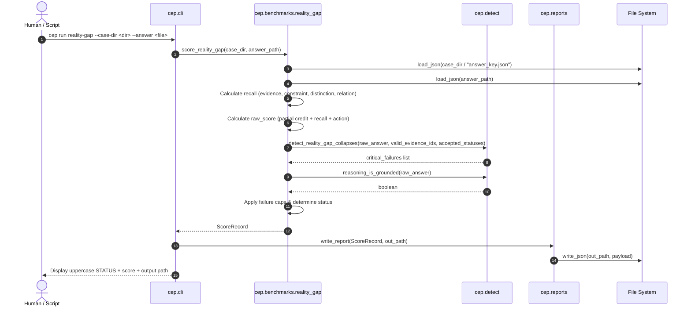

# RealityGap Answer Evaluation Workflow

## 1. Summary
The RealityGap Answer Evaluation Workflow evaluates a candidate answer against a declared benchmark case. It calculates partial credit from answer key rules, computes recall across evidence and ontological categories, scans the answer's prose and citations for semantic collapses, enforces hard score caps, and writes a validated JSON report artifact.

---

## 2. Sequence Diagram

---

## 3. Detailed Execution Path

1. **Parameter Ingestion**: `cli.py:run_reality_gap_command` validates that `--case-dir` is a directory and `--answer` is a file.
2. **Key and Answer Deserialization**:
   * `AnswerKey.model_validate(load_json(case_dir / "answer_key.json"))`
   * `RealityGapAnswer.model_validate(load_json(answer_path))`
3. **Recall Computation** (`cep.scoring.common.recall`):
   * $\text{Evidence Recall} = |E_{req} \cap E_{obs}| / |E_{req}|$ (Weight: 20 pts)
   * $\text{Constraint Recall} = |C_{req} \cap C_{obs}| / |C_{req}|$ (Weight: 10 pts)
   * $\text{Distinction Recall} = |D_{req} \cap D_{obs}| / |D_{req}|$ (Weight: 10 pts)
   * $\text{Relation Recall} = |R_{req} \cap R_{obs}| / |R_{req}|$ (Weight: 10 pts)
4. **Partial Credit Scoring**:
   * Inspects `answer_key.partial_credit_rules` for `gap_status`, `gap_type`, and `severity`.
   * Evaluates recommended action match (4 pts).
5. **Anti-Collapse Content Inspection** (`cep.detect.detect_reality_gap_collapses`):
   * Gathers valid evidence IDs from disk: `{p.stem for p in (case_dir / "evidence").glob("*.json")}`.
   * Compares `declared_state_refs` vs `observed_state_refs`.
   * Checks evidence citation validity against disk evidence IDs.
   * Scans text for absence-based leaps (`"not provided"` $\to$ `missing_evidence_as_no_gap` or `unknown_as_false`).
   * Scans for authority, possibility, or settlement conflations.
6. **Reasoning Grounding Check** (`cep.detect.reasoning_is_grounded`):
   * Asserts that `gap_summary` contains both `"declared"` and `"observed"`.
7. **Score Capping and Status Resolution**:
   * Applies minimum score caps across all fired critical failures.
   * If ungrounded, applies `UNGROUNDED_REASONING_CAP = 84.0`.
   * Assigns status (`pass`, `partial`, `fail`, `invalid`) via `status_from_score`.
8. **Report Generation**:
   * Serializes result into `reports/reality-gap/<case_id>-<answer_id>.result.json`.

---

## 4. State Changes
* **Disk Output**: Creates or updates `<out_path>` with JSON content conforming to `schemas/benchmark-result.schema.json`.

---

## 5. Failure Branches

* **Branch 5a: Critical Semantic Collapse**:
  * *Condition*: Answer commits one or more collapses (e.g., `declared_observed_collapse`).
  * *Result*: Final score capped $\le 40.0$; status forced to `invalid` or `fail`.
* **Branch 5b: Ungrounded Label Guessing**:
  * *Condition*: Answer predicts correct labels but `gap_summary` omits declared/observed grounding.
  * *Result*: Fails `reasoning_is_grounded()`. Receives `ungrounded_reasoning` warning; score capped at 84.0 (blocked from passing).
* **Branch 5c: Invalid Evidence Reference**:
  * *Condition*: Answer cites an evidence ID that does not exist in the case directory.
  * *Result*: Fired `claim_as_evidence` critical failure; score capped at 35.0.

---

## 6. Source Trail

* [benchmarks/reality_gap.py](../../src/cep/benchmarks/reality_gap.py) — `score_reality_gap()`, `CRITICAL_FAILURE_CAPS`
* [detect.py](../../src/cep/detect.py) — `detect_reality_gap_collapses()`, `reasoning_is_grounded()`
* [scoring/common.py](../../src/cep/scoring/common.py) — `recall()`, `status_from_score()`, `ScoreRecord`
* [reports.py](../../src/cep/reports.py) — `write_report()`
