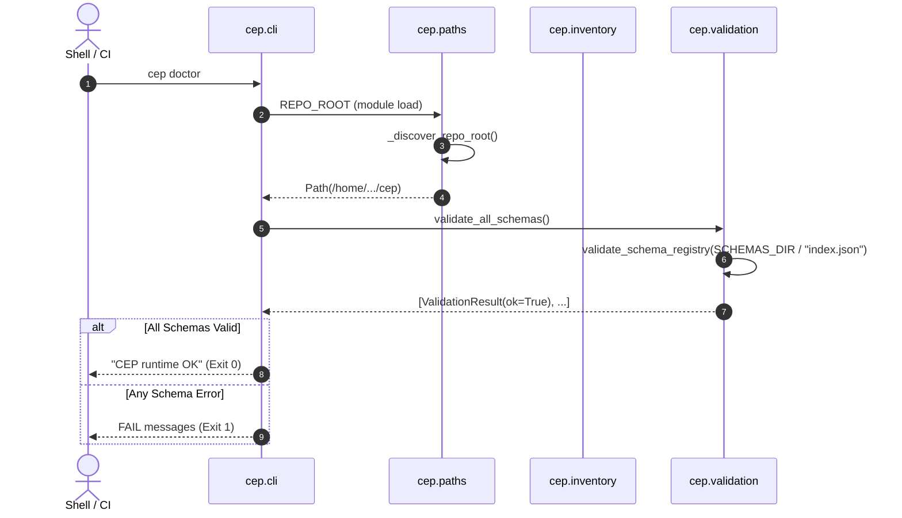

# Startup and Inventory Discovery Workflow

## 1. Summary
The Startup and Inventory Discovery Workflow initializes the CEP execution environment, dynamically resolves the absolute path to the repository root regardless of current working directory, verifies core schema contracts if requested (`cep doctor`), and dynamically enumerates benchmark cases and conformance fixtures from the directory tree without relying on static registration tables.

---

## 2. Sequence Diagram

---

## 3. Detailed Execution Path

1. **Invocation**: The user or script runs `cep <subcommand>` via Python script entry point `cep.cli:main` registered in `pyproject.toml`.
2. **Path Discovery** (`cep.paths._discover_repo_root`):
   * Inspects `os.environ.get("CEP_REPO_ROOT")`.
   * If unset, tests `Path.cwd()` and all parent directories of `Path(__file__)`.
   * A directory qualifies if `path / "schemas" / "index.json"` is a file and `path / "benchmarks"` is a directory.
3. **Registry Check** (`cep.cli.doctor`):
   * Loads `schemas/index.json`.
   * Verifies each schema listed matches the strict JSON Schema profile in `cep.schema_profile.py`.
4. **Corpus Discovery** (`cep.inventory.iter_*`):
   * When running a corpus command (e.g., `cep run reality-gap-corpus`), calls `iter_reality_gap_case_dirs()`.
   * Globs `benchmarks/reality-gap/cases/rg-*`.
   * For each directory, globs `example_*_answer.json`.

---

## 4. State Changes
* **Memory State**: Module-level constants (`REPO_ROOT`, `SCHEMAS_DIR`, `BENCHMARKS_DIR`) are bound.
* **Disk State**: Read-only during discovery. Zero temporary files created.

---

## 5. Failure Branches

* **Branch 5a: Unlocatable Repository Root**:
  * *Condition*: Invoked from an unrelated directory with no `schemas/index.json` in parents and `CEP_REPO_ROOT` unset.
  * *Consequence*: Falls back to `Path.cwd().resolve()`. Subsequent operations fail with `FileNotFoundError` when accessing `schemas/index.json`.
  * *Mitigation*: Set `export CEP_REPO_ROOT=/path/to/cep`.
* **Branch 5b: Corrupted Schema Profile**:
  * *Condition*: A registered schema contains invalid syntax or unsupported keywords.
  * *Consequence*: `doctor` reports `FAIL <path>` with error diagnostics and exits with code 1.

---

## 6. Source Trail

* [paths.py](../../src/cep/paths.py) — `_discover_repo_root()`, `_looks_like_repo_root()`
* [cli.py](../../src/cep/cli.py) — `doctor()`, `main()`
* [inventory.py](../../src/cep/inventory.py) — `iter_case_dirs()`, `iter_reality_gap_case_dirs()`
* [validation.py](../../src/cep/validation.py) — `validate_all_schemas()`
